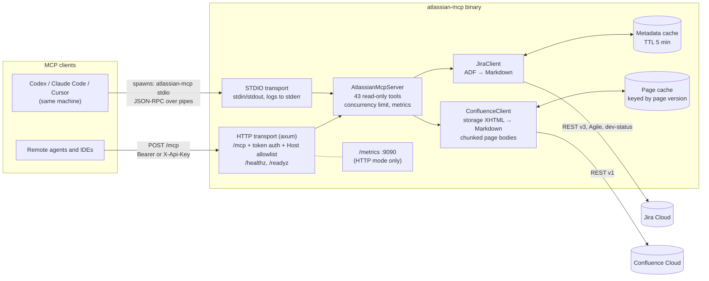

# atlassian-mcp

[](https://boosty.to/rtm00)
[](https://github.com/rtmo0/mcp-atlassian/actions/workflows/ci.yml)
[](https://github.com/rtmo0/mcp-atlassian/releases/latest)


Read-only [MCP](https://modelcontextprotocol.io) server for **Atlassian Cloud** (Jira and
Confluence). It is a single Rust binary with **two transports**:

| Mode | Command | Use it when |
|---|---|---|
| **STDIO** | `atlassian-mcp stdio` | One user on a laptop. The MCP client (Codex, Claude Code, Cursor and others) starts the server as a child process and stops it when the session ends. No port or MCP token is needed. |
| **HTTP** | `atlassian-mcp serve` | A shared or remote server. MCP is served as Streamable HTTP at `/mcp`, with token auth, health checks and Prometheus metrics. |

Both modes expose the same 43 tools and read Atlassian credentials from the same
environment variables.

## Connect in 2 minutes

### 1. Get the binary

Download an archive from [Releases](https://github.com/rtmo0/mcp-atlassian/releases)
(Linux x86_64/aarch64, macOS Apple Silicon/Intel), or build it from source:

```bash
cargo install --locked --git https://github.com/rtmo0/mcp-atlassian
```

On macOS, a binary downloaded with a browser may be quarantined. Clear the flag with
`xattr -d com.apple.quarantine /path/to/atlassian-mcp`.

### 2. Create an Atlassian API token

Create the token at <https://id.atlassian.com/manage-profile/security/api-tokens>. The
server needs these variables:

```bash
JIRA_URL=https://<site>.atlassian.net
JIRA_USERNAME=you@example.com
JIRA_API_TOKEN=<token>
CONFLUENCE_URL=https://<site>.atlassian.net/wiki
CONFLUENCE_USERNAME=you@example.com
CONFLUENCE_API_TOKEN=<token>
```

You can configure only one product. The other product's tools then return a
"not configured" error.

### 3a. Connect over STDIO (local)

**Codex** (`~/.codex/config.toml`):

```toml
[mcp_servers.atlassian]
command = "/absolute/path/to/atlassian-mcp"
args = ["stdio"]
# Forward these variables from the environment Codex runs in:
env_vars = [
  "JIRA_URL", "JIRA_USERNAME", "JIRA_API_TOKEN",
  "CONFLUENCE_URL", "CONFLUENCE_USERNAME", "CONFLUENCE_API_TOKEN",
  "JIRA_PROJECTS_FILTER", "CONFLUENCE_SPACES_FILTER",
]
# Or store the values in this file instead:
# env = { JIRA_URL = "https://<site>.atlassian.net", JIRA_USERNAME = "...", JIRA_API_TOKEN = "..." }
```

**Claude Code**:

```bash
claude mcp add atlassian \
  -e JIRA_URL=https://<site>.atlassian.net -e JIRA_USERNAME=you@example.com -e JIRA_API_TOKEN=... \
  -e CONFLUENCE_URL=https://<site>.atlassian.net/wiki -e CONFLUENCE_USERNAME=you@example.com -e CONFLUENCE_API_TOKEN=... \
  -- /absolute/path/to/atlassian-mcp stdio
```

**Cursor, Claude Desktop and other JSON-configured clients**:

```json
{
  "mcpServers": {
    "atlassian": {
      "command": "/absolute/path/to/atlassian-mcp",
      "args": ["stdio"],
      "env": {
        "JIRA_URL": "https://<site>.atlassian.net",
        "JIRA_USERNAME": "you@example.com",
        "JIRA_API_TOKEN": "...",
        "CONFLUENCE_URL": "https://<site>.atlassian.net/wiki",
        "CONFLUENCE_USERNAME": "you@example.com",
        "CONFLUENCE_API_TOKEN": "..."
      }
    }
  }
}
```

**STDIO through Docker** (run with `-i`, not `-t`):

```json
{
  "command": "docker",
  "args": ["run", "--rm", "-i",
           "-e", "JIRA_URL", "-e", "JIRA_USERNAME", "-e", "JIRA_API_TOKEN",
           "-e", "CONFLUENCE_URL", "-e", "CONFLUENCE_USERNAME", "-e", "CONFLUENCE_API_TOKEN",
           "ghcr.io/rtmo0/mcp-atlassian:latest", "stdio"]
}
```

### 3b. Connect over HTTP (shared server)

Start the server:

```bash
# Native
ATLASSIAN_MCP_API_TOKEN=<mcp-token> \
JIRA_URL=... JIRA_USERNAME=... JIRA_API_TOKEN=... \
CONFLUENCE_URL=... CONFLUENCE_USERNAME=... CONFLUENCE_API_TOKEN=... \
atlassian-mcp serve

# Docker
docker run --rm -p 8080:8080 \
  -e ATLASSIAN_MCP_API_TOKEN=<mcp-token> \
  -e JIRA_URL -e JIRA_USERNAME -e JIRA_API_TOKEN \
  -e CONFLUENCE_URL -e CONFLUENCE_USERNAME -e CONFLUENCE_API_TOKEN \
  ghcr.io/rtmo0/mcp-atlassian:latest
```

Then point the client at it:

```json
{
  "mcpServers": {
    "atlassian": {
      "type": "streamable-http",
      "url": "http://127.0.0.1:8080/mcp",
      "headers": { "Authorization": "Bearer <mcp-token>" }
    }
  }
}
```

For Codex:

```toml
[mcp_servers.atlassian]
url = "http://127.0.0.1:8080/mcp"
bearer_token_env_var = "ATLASSIAN_MCP_API_TOKEN"
```

When clients reach the server under a hostname other than localhost (a reverse proxy, a
Kubernetes Service and so on), add that hostname to `ATLASSIAN_MCP_ALLOWED_HOSTS`.
Requests with any other `Host` header are rejected.

### 4. Smoke test

STDIO:

```bash
printf '%s\n' \
  '{"jsonrpc":"2.0","id":1,"method":"initialize","params":{"protocolVersion":"2025-06-18","capabilities":{},"clientInfo":{"name":"smoke","version":"0"}}}' \
  '{"jsonrpc":"2.0","method":"notifications/initialized"}' \
  '{"jsonrpc":"2.0","id":2,"method":"tools/list","params":{}}' \
  | atlassian-mcp stdio 2>/dev/null \
  | jq -c 'select(.id == 2) | .result.tools | length'
# -> 43; the process exits when stdin closes
```

HTTP:

```bash
curl -sS http://127.0.0.1:8080/mcp \
  -H "Authorization: Bearer $ATLASSIAN_MCP_API_TOKEN" \
  -H 'Content-Type: application/json' \
  -H 'Accept: application/json, text/event-stream' \
  -d '{"jsonrpc":"2.0","id":1,"method":"tools/list","params":{}}' \
  | jq '.result.tools | length'
# -> 43
```

## Architecture



- **One core, two transports.** Both transports serve the same `AtlassianMcpServer`
  object. Tool registration and business logic exist only once. Each transport is a thin
  adapter.
- **STDIO mode** opens no network listeners. stdout carries only MCP JSON-RPC and every
  log line goes to stderr. The process exits when the client closes stdin, or on SIGINT
  or SIGTERM. HTTP-only settings (MCP token, ports, Host allowlist) are ignored.
- **HTTP mode** is stateless Streamable HTTP with JSON responses, so any replica can
  serve any request. Auth and Host checks run before a request reaches MCP. Metrics are
  served on a separate internal port.
- **Atlassian access** goes through one authenticated client per product, with retries
  on 429 and 5xx (honoring `Retry-After`). A global semaphore caps the number of
  concurrent tool calls.
- **Caches** live in process memory only. Nothing is written to disk. See
  [Caching](#caching).

## Features

- **Jira (29 tools)**: issues, JQL search, projects, fields, agile boards and sprints,
  users, worklogs, transitions, watchers, link types, changelogs, issue dates and SLA,
  development info, Service Desk, ProForma forms, attachments and images.
- **Confluence (14 tools)**: search (plain terms or CQL), pages, children, the space
  page tree, comments, labels, user search, page history, diffs and views, attachments
  and images.
- **Markdown output**: Jira ADF and Confluence storage XHTML are converted to Markdown.
- **Paginated Confluence pages**: large bodies come back in chunks with a ready-made
  `next_call` instead of being silently truncated.
- **Attachments and images**: attachments are returned as MCP `EmbeddedResource` blobs
  and images as `ImageContent`. Size and count limits apply.
- **Read-only by construction**: there are no write tools and no calls to mutating
  Atlassian endpoints.
- **Upstream-compatible**: tool names, parameters and defaults match
  [`sooperset/mcp-atlassian`](https://github.com/sooperset/mcp-atlassian) 0.21.1
  (revision `4e2b836`), and a test enforces it.

## Caching

The server caches only what it can serve without returning wrong answers:

| Cache | What | Freshness | Default size |
|---|---|---|---|
| **Metadata** | Jira fields, field contexts and options, link types, project lists, versions and components, statuses, agile boards, user lookups | TTL (`ATLASSIAN_MCP_METADATA_CACHE_TTL_SECS`, default 300 s). `jira_search_fields` with `refresh=true` bypasses and refreshes the field list | 2,000 entries |
| **Confluence pages** | Converted page bodies keyed by `(page_id, version, format)` | A page version never changes, so entries never go stale | `ATLASSIAN_MCP_PAGE_CACHE_MB`, default 64 MB, LRU, evicted after 30 min idle |

How the page cache behaves:

- **Historical versions** (`confluence_get_page_history`, `confluence_get_page_diff`)
  are fetched once and then served from memory.
- **Follow-up chunks of the current page** (`expected_version` set) send only a small
  version probe (`expand=version`). If the page is still at the expected version, the
  cached body is served without downloading and converting the page again. If the page
  changed, the full page is fetched and the usual "page changed, restart with
  `content_offset=0`" error is returned.

Never cached: issues, comments, worklogs, transitions, sprints, search results, page
trees and other live data.

Set `ATLASSIAN_MCP_METADATA_CACHE_TTL_SECS=0` or `ATLASSIAN_MCP_PAGE_CACHE_MB=0` to turn a
cache off. Every MCP client shares the caches, which is safe because every request uses
the same Atlassian credentials. Hit and miss counts are exported as
`atlassian_mcp_cache_lookups_total{cache,result}`.

## Configuration reference

### All modes

| Variable | Default | Purpose |
|---|---|---|
| `JIRA_URL` | — | `https://<site>.atlassian.net` or `https://api.atlassian.com/ex/jira/<cloud-id>` |
| `JIRA_USERNAME` | — | Atlassian account email (Basic auth). Leave empty to send the token as a Bearer token |
| `JIRA_API_TOKEN` | — | Jira API token |
| `CONFLUENCE_URL` | — | `https://<site>.atlassian.net/wiki` or `https://api.atlassian.com/ex/confluence/<cloud-id>` |
| `CONFLUENCE_USERNAME` | — | Atlassian account email |
| `CONFLUENCE_API_TOKEN` | — | Confluence API token |
| `JIRA_PROJECTS_FILTER` | — | Default comma-separated project keys for search and project lists. This is a convenience, not a security boundary |
| `CONFLUENCE_SPACES_FILTER` | — | Default comma-separated space keys for search. This is a convenience, not a security boundary |
| `READ_ONLY_MODE` | `true` | Accepted for upstream compatibility. Write tools are not implemented |
| `ATLASSIAN_MCP_REQUEST_TIMEOUT_SECS` | `60` | Atlassian HTTP timeout |
| `ATLASSIAN_MCP_RETRY_MAX` | `2` | Retries for 429, 502, 503 and 504 responses |
| `ATLASSIAN_MCP_MAX_CONCURRENCY` | `4` | Concurrent tool calls per process |
| `ATLASSIAN_MCP_MAX_CONTENT_CHARS` | `100000` | Maximum length of a text or JSON string field. Also caps the Confluence page chunk size |
| `ATLASSIAN_MCP_MAX_ATTACHMENT_BYTES` | `52428800` | Maximum bytes per inline attachment |
| `ATLASSIAN_MCP_MAX_ATTACHMENTS_PER_CALL` | `20` | Maximum attachments per call |
| `ATLASSIAN_MCP_MAX_TOTAL_ATTACHMENT_BYTES` | `104857600` | Maximum total attachment bytes per call |
| `ATLASSIAN_MCP_METADATA_CACHE_TTL_SECS` | `300` | Jira metadata cache TTL. `0` disables it |
| `ATLASSIAN_MCP_PAGE_CACHE_MB` | `64` | Confluence page cache budget. `0` disables it |
| `ATLASSIAN_OAUTH_CLOUD_ID` | — | Cloud id, required by the ProForma Forms tools |
| `JIRA_SLA_WORKING_HOURS_ONLY` | `false` | Default for `jira_get_issue_sla.working_hours_only` |
| `JIRA_SLA_WORKING_HOURS_START`, `JIRA_SLA_WORKING_HOURS_END` | `09:00`, `17:00` | Working hours (UTC) for SLA calculations |
| `JIRA_SLA_WORKING_DAYS` | `1,2,3,4,5` | Working days for SLA calculations (1 = Monday) |
| `ATLASSIAN_MCP_BUILD_VERSION` | Crate version | Version reported by the server |
| `RUST_LOG` | `info` | Log filter. Logs always go to stderr |

### HTTP mode only (`serve`)

| Variable | Default | Purpose |
|---|---|---|
| `ATLASSIAN_MCP_LISTEN` | `127.0.0.1` (`0.0.0.0` in Docker) | Listen address |
| `ATLASSIAN_MCP_PORT` | `8080` | HTTP port |
| `ATLASSIAN_MCP_API_TOKEN` | — | Token for `/mcp`. If empty, auth is disabled; use that only for local development |
| `ATLASSIAN_MCP_REQUIRE_AUTH` | `false` | Refuse to start when `ATLASSIAN_MCP_API_TOKEN` is empty |
| `ATLASSIAN_MCP_ALLOWED_HOSTS` | `localhost,127.0.0.1,::1` | Comma-separated `Host` allowlist |
| `ATLASSIAN_MCP_METRICS_PORT` | `9090` | Port for `/metrics`. `0` disables it |
| `ATLASSIAN_MCP_METRICS_LISTEN` | `127.0.0.1` (`0.0.0.0` in Docker) | Metrics listen address |

### HTTP endpoints

| Path | Auth | Purpose |
|---|---|---|
| `/mcp` | Token, if configured | MCP Streamable HTTP |
| `/` | Public | Name, version, products and tool count |
| `/healthz`, `/api/healthz` | Public | Liveness |
| `/readyz`, `/api/readyz` | Public | `503` when no product is configured |
| `:9090/metrics` | Public, separate port | Prometheus metrics |

Clients authenticate with `Authorization: Bearer <token>` or `X-Api-Key: <token>`.

## Tools

### Jira (29)

| Tool | Purpose |
|---|---|
| `jira_get_issue` | Issue with fields and comments, ADF converted to Markdown |
| `jira_search` | JQL search (`/rest/api/3/search/jql`, `nextPageToken`) |
| `jira_get_project_issues` | Issues of a project |
| `jira_get_all_projects` | Accessible projects |
| `jira_get_project_versions` / `jira_get_project_components` | Project metadata |
| `jira_search_fields` / `jira_get_field_options` | Field discovery and allowed options |
| `jira_get_user_profile` | User profile by email or account id, or `currentUser()` |
| `jira_get_transitions` | Available status transitions |
| `jira_get_worklog` | Worklog entries |
| `jira_get_issue_watchers` | Issue watchers |
| `jira_get_link_types` | Issue link types |
| `jira_get_agile_boards` / `jira_get_board_issues` | Agile boards and board issues |
| `jira_get_sprints_from_board` / `jira_get_sprint_issues` | Sprints and sprint issues |
| `jira_batch_get_changelogs` | Bulk changelogs (Cloud) |
| `jira_get_issue_dates` | Created, updated and resolution dates plus status history |
| `jira_get_issue_sla` | Cycle time, lead time, time in status, due date and more |
| `jira_get_issue_development_info` / `jira_get_issues_development_info` | Development panel (branches, commits, PRs) |
| `jira_get_service_desk_for_project` / `..._queues` / `..._queue_issues` | Service Desk (Server/DC-only upstream) |
| `jira_get_issue_proforma_forms` / `jira_get_proforma_form_details` | ProForma forms (require a cloud id) |
| `jira_download_attachments` / `jira_get_issue_images` | Attachments and inline images |

### Confluence (14)

| Tool | Purpose |
|---|---|
| `confluence_search` | Plain query or CQL search |
| `confluence_get_page` | Page by ID, or by title and space key |
| `confluence_get_page_children` | Child pages and folders |
| `confluence_get_space_page_tree` | Flat page hierarchy of a space |
| `confluence_get_comments` | Page comments |
| `confluence_get_labels` | Content labels |
| `confluence_search_user` | User search via CQL |
| `confluence_get_page_history` | A historical page version |
| `confluence_get_page_diff` | Unified diff between versions |
| `confluence_get_page_views` | View statistics (Cloud) |
| `confluence_get_attachments` | Attachment metadata |
| `confluence_download_attachment` | One attachment as an embedded resource |
| `confluence_download_content_attachments` | All attachments as embedded resources |
| `confluence_get_page_images` | Inline images as MCP image content |

### Large Confluence pages

`confluence_get_page` and `confluence_get_page_history` return page bodies in chunks
instead of truncating them at `ATLASSIAN_MCP_MAX_CONTENT_CHARS`. Pass `content_offset`
(0-based, counted in Unicode characters) and `content_limit` (default
`min(100000, MAX_CONTENT_CHARS)`). Keep requesting chunks while
`content.pagination.has_more` is true, using the arguments in `content.next_call`. With
`include_metadata=true` (the default), the same fields are under `metadata.content`:

```json
{
  "content": {
    "value": "...",
    "format": "markdown",
    "pagination": {
      "offset": 0,
      "limit": 100000,
      "returned": 100000,
      "total": 1288543,
      "has_more": true,
      "next_offset": 100000,
      "page_version": 89
    },
    "next_call": {
      "tool": "confluence_get_page",
      "arguments": {
        "page_id": "6264782851",
        "content_offset": 100000,
        "content_limit": 100000,
        "convert_to_markdown": true,
        "include_metadata": false,
        "expected_version": 89
      }
    }
  }
}
```

Rules for reading chunks:

- For `confluence_get_page`, pass `expected_version` (the `page_version` of the previous
  chunk) whenever `content_offset > 0`. The server returns an error if the page was
  edited between chunks.
- `confluence_get_page_history` is already pinned by its `version` parameter.
- Keep `convert_to_markdown` the same across chunks. Markdown and storage format are
  different strings, so their offsets differ.
- Chunks split on Unicode scalar values and may cut through grapheme clusters or
  Markdown markup. Concatenate all chunks before rendering or parsing.
- Small pages requested without pagination parameters keep the original response shape.

## Security notes

- The code contains only read paths. Two endpoints use POST but only read data: Jira JQL
  search (`/rest/api/3/search/jql`) and the Jira changelog bulk fetch
  (`/rest/api/3/changelog/bulkfetch`).
- `jira_get_issue` accepts `update_history` for schema compatibility but never sends
  `updateHistory=true`, so it does not modify the user's view history.
- Secrets are read only from environment variables. They are never logged or included in
  error messages.
- Attachments and cached data are held in memory only. No temporary files are written,
  so the container can run with a read-only root filesystem.
- `JIRA_PROJECTS_FILTER` and `CONFLUENCE_SPACES_FILTER` are not access controls. Limit
  access through the Atlassian account's permissions.
- An API token may lack scopes for Jira Agile, Confluence user search, dev-status or
  ProForma. Those tools return the upstream-style error and every other tool keeps
  working.

## Installation options

| Method | Command |
|---|---|
| Release binary | Download from [Releases](https://github.com/rtmo0/mcp-atlassian/releases). The `.sha256` files hold checksums |
| Cargo | `cargo install --locked --git https://github.com/rtmo0/mcp-atlassian` |
| From a checkout | `cargo build --release --locked` produces `target/release/atlassian-mcp` |
| Docker | `docker pull ghcr.io/rtmo0/mcp-atlassian:latest` (`linux/amd64`, `linux/arm64`) |

Building from source needs a stable Rust toolchain (edition 2024) plus `cmake` and a C
compiler for `aws-lc-rs`.

Docker tags: `latest`, `X.Y.Z` and `X.Y` come from release tags `vX.Y.Z`; `edge` tracks
`main`; `sha-<short>` is published for every build. The image runs `serve` by default.
Pass `stdio` as the command to use the STDIO transport.

## Development

```bash
cargo fmt --all
cargo clippy --all-targets -- -D warnings
cargo test
```

- `tests/stdio.rs` starts the real binary in STDIO mode. It checks that stdout contains
  only JSON-RPC, that `tools/list` returns 43 tools and that the process exits on EOF.
- `src/server/mod.rs` compares every tool's input schema with
  `research/tools-list-0.21.1.json`, the upstream `tools/list` snapshot. Regenerate the
  snapshot with `scripts/snapshot-upstream-tools.sh` (requires
  [`uv`](https://docs.astral.sh/uv/)).

### CI and releases

- **CI** (`.github/workflows/ci.yml`) runs on every push and PR: `fmt`, `clippy` and
  tests on Linux and macOS, plus a Docker build with an in-container STDIO smoke test.
- **Docker** (`.github/workflows/docker.yml`) builds `linux/amd64` and `linux/arm64`
  natively and pushes `ghcr.io/rtmo0/mcp-atlassian` on pushes to `main` and on tags.
- **Release** (`.github/workflows/release.yml`) runs on a `vX.Y.Z` tag. The tag must
  match `version` in `Cargo.toml`. It builds Linux and macOS binaries and attaches them
  with SHA-256 checksums to a GitHub Release.

To cut a release, bump `version` in `Cargo.toml`, commit, then:

```bash
git tag v0.1.0 && git push origin v0.1.0
```

## Support

atlassian-mcp is free and open source. If it saves you time, you can support development on [Boosty](https://boosty.to/rtm00). Bug reports and pull requests help a lot too.

## License

Licensed under either of [Apache License, Version 2.0](LICENSE-APACHE) or
[MIT license](LICENSE-MIT), at your option.

Tool names, parameter contracts and behavior are ported from `mcp-atlassian`
(MIT, Copyright (c) 2024 Hyeonsoo Lee). See [THIRD_PARTY_NOTICES.md](THIRD_PARTY_NOTICES.md).
